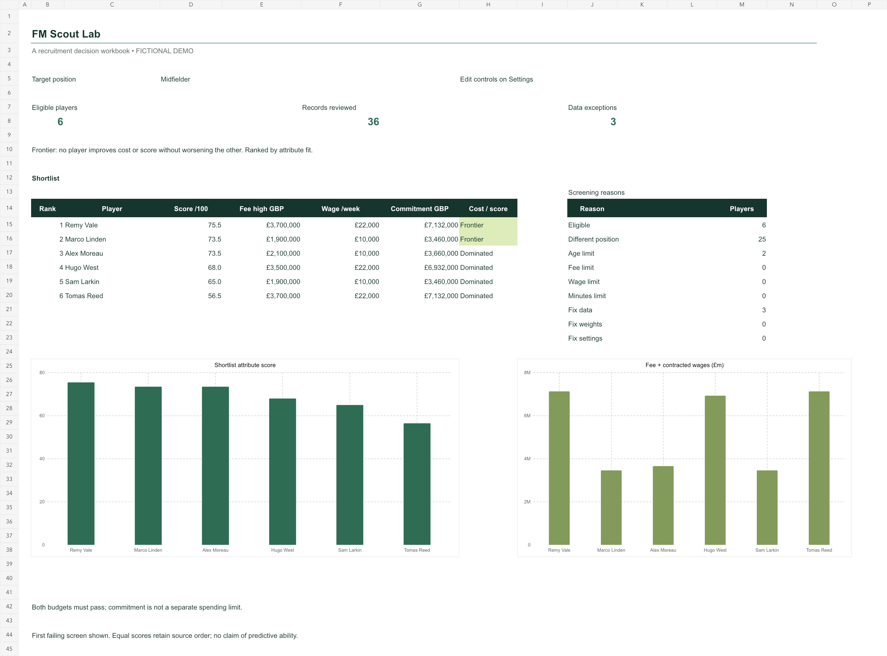
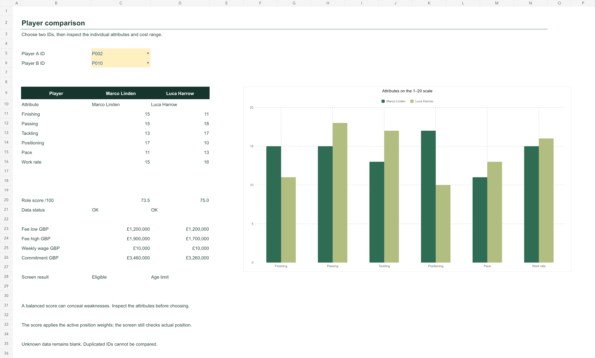

# FM Scout Lab

**An Excel recruitment desk for making player shortlists you can explain.**

Football Manager makes it easy to collect a long list of interesting players. The harder question is which ones suit a particular job, fit both budgets, and deserve more scouting. This workbook makes the filters, trade-offs and missing information visible.

[Download the Excel workbook](https://github.com/abasukanga4/fm-scout-lab/raw/refs/heads/main/workbook/FM%20Scout%20Lab.xlsx) · [How the model works](docs/methodology.md) · [Bring your own data](docs/import-guide.md)



## Try it in two minutes

1. Download `workbook/FM Scout Lab.xlsx` and open it in a spreadsheet application with automatic calculation enabled. No macros or external connections are required.
2. On **Settings**, change the target position, transfer limit, wage limit, maximum age or minimum minutes. Amber cells are editable controls.
3. Return to **Scout Desk**. The eligible count, ranked shortlist, rejection reasons and native charts recalculate.
4. On **Compare**, select two player IDs to see their attributes and costs side by side.
5. On **Model**, filter `Data status` or `Screen result` to investigate why someone was excluded.

The workbook contains **36 entirely fictional demonstration records**, including three deliberate data-quality cases. It is not an export from a personal save, a real scouting report, or a Sports Interactive product. It supports up to **60 input rows** and displays the top six eligible players; the full eligible set remains filterable in Model.

## What makes the analysis useful

- **Two budget constraints:** a low weekly wage cannot hide a transfer fee above the limit, or vice versa. Screening uses the upper fee estimate.
- **Position-specific weights:** `SUMPRODUCT` applies a visible six-attribute profile. The selected weights are retrieved with `INDEX` and `MATCH`, and must be valid percentages totalling 100%.
- **Deterministic ranking:** `COUNTIFS` ranks eligible players only, with source order breaking equal-score ties.
- **Cost/score frontier:** a player is marked dominated when another eligible player scores at least as well at no greater cost, with at least one strict improvement. This reveals trade-offs without claiming to identify an objectively best player.
- **Explicit data-quality gates:** missing prices or attributes, duplicated IDs, invalid position mappings and impossible ranges are excluded. Unknowns never become attractive zero-cost deals.
- **Auditable workbook:** native tables, filters, dropdown validation, conditional formatting and three editable range-linked charts. Model formulas and sources remain visible.
- **Repeatable import checks:** a small standard-library Python utility handles canonical CSVs, explicit currency suffixes, duplicate IDs, missing values, unsafe text and the workbook's capacity limit.

## A decision from the demo

With the default midfielder controls, six players pass. Remy Vale scores **75.5** with a three-year fee-plus-wage commitment of **£7.132m**. Marco Linden scores **73.5** at **£3.460m**. The extra two score points would cost **£3.672m** under these assumptions. Both lie on the cost/score frontier.

Alex Moreau also scores 73.5 but costs £3.660m, so Marco dominates that option on these two measures. That is a prompt to investigate other reasons for choosing Alex, not proof that Alex is a worse footballer. The deliberately limited score excludes factors such as personality, injuries, footedness, tactical familiarity and league context.



## Workbook map

| Sheet | Purpose |
|---|---|
| Scout Desk | Eligible shortlist, cost/score frontier, screening counts and charts |
| Compare | Two player selectors, attribute comparison and commitment estimates |
| Model | Traceable checks, weighted scores, budget screens, ranks and dominance counts |
| Settings | Editable constraints, four weight profiles and validity checks |
| Players | Typed source records and blank input capacity |

## Validation

```bash
python -m unittest discover -s tests -v
python src/prepare_csv.py data/demo_players.csv --output local-data/normalized.csv --report local-data/quality-report.json
```

The tests independently check the committed workbook's cached shortlist, scores, costs and frontier against the CSV, and inspect formula, chart, table and validation features. They also test input failures including masked ranges, wrong currency/units, duplicate IDs and silent truncation. CI checks the saved artefact; it does not run Microsoft Excel.

During workbook validation, edits to zero budget, invalid weights and duplicate comparison IDs were tested, then default controls restored. A separate LibreOffice recalculation matched the default eligible count, scores and exception count, with no formula errors. Every sheet was visually reviewed. Full Microsoft Excel desktop interaction remains unverified because the local activation/open-file workflow prevented that check. See [validation notes](docs/validation-notes.md) for the exact scope.

## Scope and limitations

This is an Excel decision-support project, not a predictive recruitment model or a squad optimiser. Scores are preferences, not probabilities or hidden current/potential ability. Costs exclude bonuses, add-ons, agent fees, taxes and resale value. Position groups require manual judgement. No player is automatically signed, no game files are modified and no online service is contacted by the workbook.

The committed `.xlsx` is the editable model source. Formula definitions are also recorded in [the formula catalogue](docs/formula-catalog.json). The import utility prepares data; it does not regenerate workbook layouts or connect directly to a particular Football Manager version.
